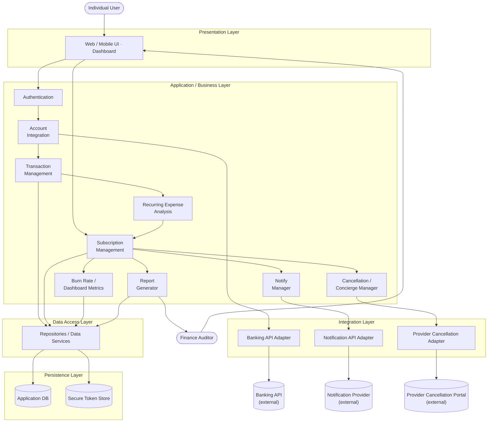

# Lab 3 — Component Modelling & Architectural Pattern Selection

**Problem Statement #32 — Personal Subscription & Recurring Expense Auditor**

**Author:** Sai Rishi Gangarapu · SRN PES1UG24CS400 · Course: Software Engineering

📄 Full submission: [`PES1UG24CS400_Lab3.pdf`](./PES1UG24CS400_Lab3.pdf)

## Scope

Building on the [Lab 1](../Lab1/) requirements and use-case model, this lab selects the system's
architectural pattern — a **Layered Architecture with Modular Component Decomposition** — and
derives a component model in which business modules stay cohesive while banking, notification,
and provider-cancellation dependencies are isolated behind integration components.

**Layers:** Presentation → Application/Business → Integration → Data Access → Persistence

## Component Diagram

## Component Catalogue

| Component | Responsibility |
|---|---|
| Authentication | Authenticates users, manages sessions; kept separate from financial data processing |
| Account Integration | Read-only banking-API connection; imports account/transaction data |
| Transaction Management | Validates, normalizes, stores and retrieves imported transactions |
| Recurring Expense Analysis | Detects recurring billing patterns; estimates renewal dates and monthly cost |
| Subscription Management | Maintains subscription records: provider, status, renewal date, recurring cost |
| Burn Rate / Dashboard | Aggregates active recurring expenses into monthly burn-rate metrics |
| Notification Manager | Schedules renewal alerts ≥ 72 hours before an identified renewal |
| Cancellation / Concierge Manager | Provider-specific cancellation guides/links; optional authorized concierge workflows |
| Report Generator | Anonymized aggregated monthly burn-rate reports (CSV/PDF) for the Finance Auditor |
| Data Access Layer | Repository interfaces so business components never depend on storage directly |
| Secure Token Store / DB | Persists application records and tokenized (never raw) integration credentials |

## Traceability to Lab 1 Requirements

| Requirement | Mapped Components |
|---|---|
| FR-001 (recurring detection) | Transaction Management · Recurring Expense Analysis · Subscription Management |
| FR-002 (read-only bank import) | Authentication · Account Integration · Data Access |
| FR-003 (72-hour alerts) | Subscription Management · Notification Manager |
| FR-004 (cancellation guides) | Cancellation/Concierge Manager · Provider Adapter |
| FR-005 (anonymized reports) | Report Generator · Data Access |
| NFR-001 (no cleartext credentials) | Authentication · Account Integration · Secure Token Store |
| NFR-002 (2 s burn rate @ 10k records) | Burn Rate/Dashboard · Recurring Analysis · Data Access |

## Evolution

This lab's layered model is the architectural baseline that the implementation evolves:
[`docs/ARCHITECTURE.md`](../docs/ARCHITECTURE.md) carries it forward as a layered modular
monolith (Fastify JS backend + React TSX frontend) with an internal Transactional Outbox,
multi-table DynamoDB persistence, and WorkOS identity.
